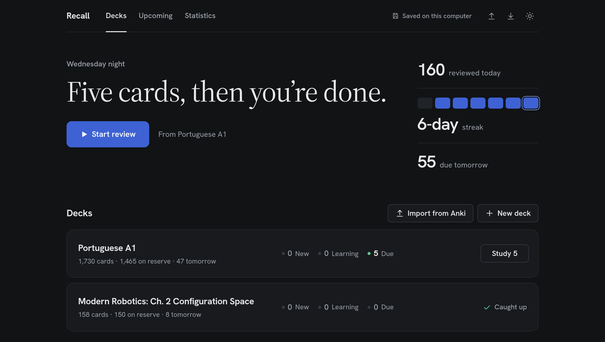
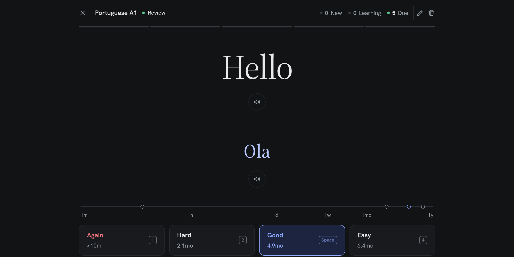

# Recall

A small, fast flashcard app with Anki's scheduling and a cleaner interface. It runs on your own computer, keeps your cards in a plain file you own, and reads cards aloud: English on one side, European Portuguese on the other.





## Features

- **Decks and cards.** Create as many decks as you like; add, edit, move, search and delete cards.
- **Filters.** Narrow a deck's card list to new, learning, due, not-yet-due or reserve cards, by when the next review falls, when a card was added or how often it was forgotten, and sort it. Tick cards, or everything the filters show, to delete them together.
- **Maths and images.** Build equations in a visual editor, or write them in LaTeX, and they are typeset on the card. Paste a screenshot, drop a picture or pick a file to put it on either side.
- **Import from Excel.** Turn a spreadsheet of words into cards in one step, pictures and maths included.
- **Import from Anki.** Bring in an `.apkg` file and carry on where you left off: every card keeps its due date, interval and ease, and its images and maths.
- **Anki's scheduler.** Ported from Anki's source: its default algorithm (SM-2), and FSRS-6 as a per-deck option, with the same learning steps, relearning, interval fuzz and 4am day rollover.
- **Intervals on the buttons.** Again, Hard, Good and Easy each show when the card would come back.
- **A reserve.** Keep cards aside in a deck, out of study, and pull in as many as you like when you are ready for them, in an order you can rearrange. Fill it from a CSV or Excel file, or with reversed copies of cards you choose.
- **Upcoming cards.** How many cards come up on each day of the next week, month or three months, new, learning and due, for one deck or all of them.
- **Statistics.** A forecast of upcoming reviews, a year-long activity calendar, how many cards are new, learning, young and mature, and how often you press each answer button.
- **Read aloud.** A speaker button on each side of a card, a language for each side, optional auto-play, and an adjustable speaking speed. Maths and images are skipped. Audio is generated once per sentence and cached, unless a deck is set not to keep it.
- **Your data in a file.** Everything is saved to `data/recall.json`, with a dated backup each day, and images to `data/media/`.
- **Keyboard-first studying**, light and dark themes, and a layout that works on a phone.
- **No dependencies to install.** The app is plain HTML, CSS and JavaScript; the server is one Node file. [KaTeX](https://katex.org), which typesets the maths, and [MathLive](https://mathlive.io), the equation editor, are included in `vendor/`, so maths works offline.

## Quick start

You need [Node.js](https://nodejs.org) 20 or newer. Importing from Anki needs 22.15 or newer.

```bash
git clone https://github.com/mahen2-cmd/recall.git
cd recall
npm start
```

Open **http://localhost:5173**. That's all that is needed to make decks and study.

For the full set of voices, run this once (needs Python 3; `ffmpeg` is optional):

```bash
npm run setup-voice
```

## Studying

A new card starts with Anki's default learning steps:

| Button | New card | What it does |
|---|---|---|
| **Again** | <1m | Back to the first step |
| **Hard** | <6m | Stays on the current step |
| **Good** | <10m | Moves to the next step, then graduates to review |
| **Easy** | 4d | Graduates straight away |

After that, the schedule depends on the deck's scheduling setting:

- **Anki default** (SM-2). Each interval is the previous one multiplied by the card's ease, which starts at 250%. Pressing Good every time gives 1, 3, 8, 20, 50, 125 days and so on. Easy adds a 30% bonus and raises the ease; Hard grows the interval by 20% and lowers the ease.
- **FSRS.** Intervals come from a model of how well you remember each card, aiming for the deck's desired retention. This is what Anki does when FSRS is switched on.

In both, forgetting a review card sends it through one 10-minute relearning step. A deck can switch between the two at any time, because both sets of scheduling data are kept for every card.

### Keyboard shortcuts

| Key | Action |
|---|---|
| `Space` or `Enter` | Show the answer, then rate Good |
| `1` `2` `3` `4` | Again, Hard, Good, Easy |
| `R` | Replay the audio |
| `E` | Edit the current card |
| `Ctrl` + `Enter` | Save in the card editor |

### Deck settings

Each deck has its own:

- **New cards per day** (default 20).
- **Easy interval** (default 4 days): how far out Easy sends a card you are learning for the first time. With FSRS, 0 lets FSRS choose, which is what Anki does.
- **Scheduling**: Anki default or FSRS.
- **FSRS retention** (default 90%). Higher means fewer forgotten cards and more reviews.
- **Auto-play audio**: off, front, back or both sides.
- **Front language** and **Back language** (default English (US) and Portuguese): the language each side is read in.
- **Speaking speed**, from normal down to very slow.
- **Keep the audio made for this deck** (on by default). Turn it off for decks that are mostly maths: audio is then made each time a side is played and thrown away after, and `npm run cache-voice` leaves the deck out.

## Maths and images

### Maths

In the card editor, press **Maths** above a side to open the equation editor, and type the maths as it looks:

- `/` starts a fraction, `^` a power and `_` a subscript. The arrow keys move out of them, and between the cells of a matrix.
- Type `sqrt`, `theta`, `omega`, `pi`, `sum` and the like by name.
- The buttons above the box insert a fraction, a square root, a power, a subscript, a dot (ẋ), a vector arrow, and 2×2, 3×3 and 4×4 matrices. The menu at the end of the box has more, including matrices of any size.
- On a phone, a maths keyboard opens.
- Tick **On a line of its own** to centre the maths on its own line, and press **Insert** or Enter.

To change maths already on a card, click it in the preview under the text box, or put the cursor in it and press **Maths**.

The editor writes LaTeX into the card, and you can also type LaTeX yourself between these markers:

| Write | For |
|---|---|
| `\( ... \)` | maths within a line of text |
| `\[ ... \]` | maths on a line of its own, centred |

For example:

```
Back:  \[ R_z(\theta) = \begin{bmatrix} \cos\theta & -\sin\theta & 0 \\ \sin\theta & \cos\theta & 0 \\ 0 & 0 & 1 \end{bmatrix} \]
Back:  Through the Jacobian: \( \dot{x} = J(q)\,\dot{q} \)
```

These are the markers Anki uses, so cards written for Anki work unchanged. A dollar sign is never taken for maths. The card editor shows a preview of a side as soon as it holds maths or an image, and a formula with a mistake in it is shown in red rather than hiding the card.

The equation editor is [MathLive](https://mathlive.io), included in `vendor/` and loaded the first time it is opened.

### Images

In the card editor, put an image on a side in any of these ways:

- **Paste** it into the side's text box, for example a screenshot copied from a page of a book.
- **Drop** an image file onto the text box.
- Press **Add image** above the text box and choose one or more files.

PNG, JPEG, GIF, WebP and SVG images up to 20 MB are accepted. Each is kept in `data/media/` and appears in the text box as `[image:...]`, which you can move about like any other text or delete to take the image off the card. The same picture added twice is only kept once. Images are kept by the server, so they need the app to be started with `npm start`.

### Reading aloud

Only a side's words are read: maths and images are skipped, and a side with nothing else on it has no speaker button.

## The reserve

Each deck has a reserve: cards that are kept in the deck but out of study, so they are not counted as new cards and never come up, until you pull them in.

- **Add to it** with **Import to reserve** on the deck's page, which takes a CSV or Excel file with one column for the front and one for the back. The ordinary import and the card editor also have a reserve checkbox.
- **Pull from it** by typing how many cards you want and pressing **Pull in**, or take everything with **Pull all**. Cards come out from the front of the reserve, and are then studied in that order, after the new cards already waiting.
- **Reorder it** with **Reorder**, which lists the reserve in the order it is pulled in. Drag a card to a new place, or tick several and drag one of them, or use **Up**, **Down**, **To top** and **To bottom**, to move them together. Until you rearrange it the reserve is oldest first, which for an imported file is the order of its rows; cards added afterwards join the end.

- **Add reversed cards** by ticking cards in the deck's list and pressing **Add reversed**. Each ticked card gets a copy with its front and back swapped, placed at the end of the reserve with a schedule of its own, and left ticked so you can move the copies straight away. A card that already has a reversed version in the deck is skipped. A reversed card is read aloud in the right language on each side, and auto-play follows the language rather than the side.

Pulled cards become ordinary new cards, so they are introduced at the deck's new cards per day; raise that setting to study more of them at once. To put cards back, tick them in the deck's list, whether new, learning or due, and press **Back to reserve**; they join the end of the reserve. A card that has already been studied loses its progress and starts over as a new card when pulled in again, so you are asked first.

## Statistics

The chart button in the top bar opens the statistics for all decks; the one on a deck's page opens that deck's. Choose a period of 1 month, 3 months or 1 year.

- **Forecast.** The reviews already scheduled for each coming day (or week, or 30 days, for the longer periods). Today's bar includes anything overdue. New cards are not counted.
- **Activity.** A calendar of the past year, darker on days with more reviews.
- **Cards.** How many are new, learning, young (in review with an interval under 21 days) and mature (21 days or more), as in Anki.
- **Answer buttons.** How often you pressed Again, Hard, Good and Easy on learning, young and mature cards. **Retention** is the share of young and mature reviews that were not answered Again.

Recall records which button was pressed, and in which deck, from the version that added this page. Reviews done before that still count towards the activity calendar and the streak for all decks, but have no per-deck or per-button breakdown.

## Upcoming cards

The calendar button in the top bar lists the cards coming up for all decks; the one on a deck's page, or **See the days ahead** under its counts, lists that deck's. Choose to look 1 week, 1 month or 3 months ahead.

- **Totals** for today, tomorrow, the next 7 days and the next 30 days.
- **A chart** of each day, split into new, learning and due cards.
- **Day by day**, a table of every day with its new, learning and due cards and their total. Weeks start on a Monday.

Today counts what is waiting now, overdue cards included. Later days count the reviews already scheduled for them, and new cards at each deck's daily limit until there are none left, supposing you study every day. The cards you study come back on later days too, so those days fill up as you go. Cards on reserve are not counted until they are pulled in.

## Importing from Excel

Open a deck and press **Import**, then choose a file. Each row becomes one card.

- **Files:** Excel `.xlsx`, or `.csv` and tab-separated text. Old `.xls` files need to be saved as `.xlsx` first.
- **Columns:** pick which column is the front and which is the back. Column A and B are used by default.
- **Header row:** tick the box if the first row holds column titles.
- **Duplicates:** rows whose front is already in the deck are skipped, so the same file can be imported again after you add to it.
- **Preview:** the dialog shows the first cards and how many rows will be skipped before anything is added.
- **Maths:** cells can hold maths written with `\( ... \)` and `\[ ... \]`, as on any card.
- **Pictures:** a picture placed in a cell (**Insert → Pictures → Place in Cell** in Excel) goes on that side of the card. So does a picture floating over the sheet, by the cell under its top-left corner; in LibreOffice, anchor it **To Cell**. Pictures Recall cannot show, such as drawings Excel saves as EMF, are left out, and the app says how many.

Only the first sheet of a workbook is read, and rows missing either a front or a back are left out. Imported cards are new cards, in the order they appear in the file.

## Importing from Anki

In Anki, choose **File → Export**, pick **Anki Deck Package (.apkg)** and leave **Include scheduling information** ticked. In Recall, press **Import from Anki** on the deck list and choose that file. A dialog lists the decks and cards found before anything is added.

Each Anki deck becomes a Recall deck, and each card arrives exactly where it was in Anki's schedule:

- **Review cards** keep their due day, interval and ease, so the cards due today in Anki are the cards due today in Recall, and the next interval is worked out from the same numbers.
- **Learning and relearning cards** keep their step and the time they are next due.
- **New cards** stay new, in Anki's order.
- **Deck options** come across too: new cards per day, the easy interval, whether FSRS is on, and with FSRS the desired retention, the deck's parameters and each card's memory state.

Some things do not come across:

- Cards become plain text with their images and maths. Formatting and audio are dropped, and suspended cards are left out. Maths written for Anki's MathJax (`\(...\)` and `\[...\]`) is kept as it is, and Anki's `[$]...[/$]` and `[$$]...[/$$]` become the same. Images are copied into `data/media/` as soon as the file is read, before the import is confirmed.
- Recall has no setting for custom learning steps, starting ease, easy bonus and the like. If a deck changes these in Anki, the dialog says which, and Recall uses Anki's defaults for them.
- The review history itself is not kept, only the schedule it led to.

Tick **Put these cards on reserve** in the dialog to keep the new cards out of study until you pull them in, in Anki's order. Cards already being studied in Anki keep their schedule either way.

Importing the same file again adds only the cards that are not in Recall yet. It does not update cards already imported, so reviews done in Anki afterwards are not picked up.

## Voices

The speaker reads each side of a card in the language set for it in the deck's settings: European Portuguese, or US or UK English. Several voice engines are supported, and the best one available is used automatically:

| Engine | Needs | Notes |
|---|---|---|
| Azure neural voices | An Azure Speech key | Official and supported |
| Google Translate | Nothing | The default. Unofficial |
| Microsoft Edge voices | `npm run setup-voice` | Unofficial |
| Piper | `npm run setup-voice` | Fully offline; the fallback when nothing else is reachable. Portuguese only |

The Google Translate and Edge engines use addresses those companies do not publish for this purpose, so either could stop working without notice. When one fails, the next engine takes over. If the Edge voice breaks, running `npm run setup-voice` again updates it.

To have every card ready to be read aloud, reserve included, run `npm run cache-voice`. Decks set not to keep their audio are left out. It saves the audio for both sides of each card ahead of time, so studying never waits on the voice engine or needs the internet. Clips already saved are skipped, so it can be stopped at any time and run again to carry on, or to fetch the cards added since. It pauses after each new clip to go easy on the engine (`npm run cache-voice -- --delay=1500` to pause longer), and stops if the first-choice engine stops answering rather than filling in with a fallback voice.

To change the engine or voice, create `data/tts.json`. Every field is optional:

```json
{
  "engine": "google",
  "voice": "pt-PT-RaquelNeural",
  "azureKey": "your-key",
  "azureRegion": "westeurope"
}
```

- `engine` is `google`, `edge`, `piper` or `azure`.
- `voice` applies to Edge and Azure, for example `pt-PT-DuarteNeural` for a male voice. It is used for its own language; the other languages use a standard voice.
- `azureKey` and `azureRegion` come from a Speech resource in the Azure portal.

Changes take effect on the next sentence played; no restart is needed.

## Your data

| Path | Contents |
|---|---|
| `data/recall.json` | Every deck, card and its learning progress |
| `data/backups/` | A copy from the start of each day you used the app; the last 30 are kept |
| `data/audio/` | Cached audio, one file per sentence per voice |
| `data/media/` | The images on cards, named by their contents |
| `data/tts.json` | Voice settings and keys, if you created it |

The `data/` folder is git-ignored, so none of it is ever committed.

- To keep the data somewhere else, such as a synced folder, start with `RECALL_DATA=/path/to/folder npm start`.
- The download and upload buttons in the top bar export and import everything as one JSON file. Images are not in that file; copy `data/media/` with it.
- Deleting a card or deck leaves its images in `data/media/`, as other cards may show the same ones.
- The top bar shows where data is going. If the server stops while the tab is open, it warns you; changes are held in the browser and written to the file when the server is back.
- Use one tab at a time. Two open tabs overwrite each other's changes.

The server listens only on your own machine and rejects requests from other websites.

## How it works

```
index.html          the page
css/styles.css      all styling, light and dark
js/fsrs.js          the scheduler: Anki's SM-2 and FSRS-6 modes, with no browser code
js/store.js         decks, cards, the study queue and saving
js/content.js       finds the maths and images in a card's text, and the words to read aloud
js/importer.js      reads .xlsx and CSV files into rows, with their pictures
js/app.js           the interface
server.js           serves the app, reads and writes data/recall.json, and keeps images
anki.js             reads an Anki package into decks and cards, with their images
vendor/katex/       KaTeX 0.18.11, which typesets maths (MIT licence)
vendor/mathlive/    MathLive 0.111.1, the equation editor, which uses KaTeX's fonts (MIT licence)
tts.js              the voice engines and the audio cache
tests/              unit tests for the scheduler, the store and the importers
```

The scheduler follows two sources: the memory model from [fsrs-rs](https://github.com/open-spaced-repetition/fsrs-rs), which Anki uses, and the learning, review and fuzz rules from [Anki's scheduler](https://github.com/ankitects/anki/tree/main/rslib/src/scheduler/states).

Run the tests with:

```bash
npm test
```

## Differences from Anki

- Fuzz uses Anki's interval ranges but a different random generator, so the exact day chosen within a range will not match Anki card for card.
- Learning steps are fixed at 1 and 10 minutes, and the relearning step at 10 minutes. The other Anki default options (starting ease, easy bonus, hard interval and so on) are fixed at Anki's defaults too.
- Easy on a new card gives exactly the easy interval; Anki varies it by a day either way.
- FSRS uses its default parameters; they are not optimised from your review history.
- There is no load balancer and no review limit per day, and cards have no templates.
- Cards are plain text, with maths and images. Maths is typeset with KaTeX rather than MathJax, which covers nearly all the same LaTeX.
